<h1 align="center">Pokémon Red and Blue: Rooster Edition</h1>

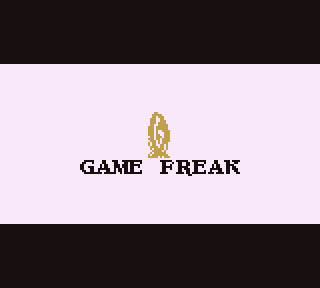

<b>151 COCK. One dream. Absolutely no ducks.</b> <i>(Except the duck.)</i>

Pokémon Red and Blue, rebuilt from the ground up as a game about chickens. Nearly all of the 151 are real breeds, hand-drawn, with its own colours on a Game Boy Color. Your starter is a Rhode Island Red chick. Your rival's is better. Kids still fight birds for money, and this time the game has something to say about it.

  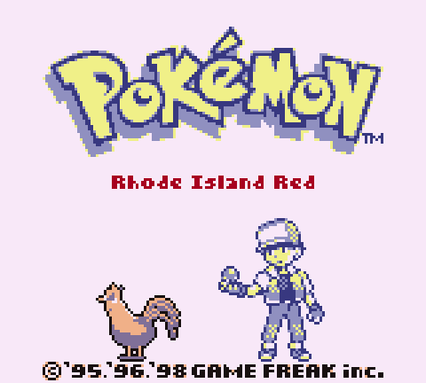
  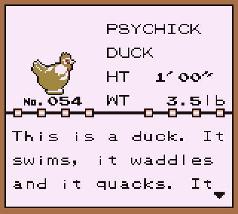
  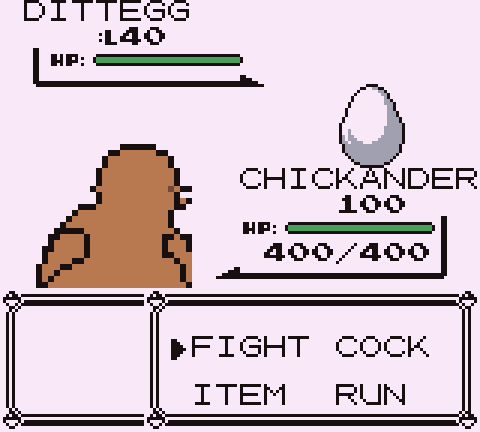

## What's in the coop

- **151 breeds**, from Serama bantams to Brahma giants. CHICKANDER, PECKACHU, SILKYPUFF and SNOROOSTER are all here.
- **One of them is a goose.** Nobody talks about the goose.
- **Redrawn almost to the last feather:** fronts, backs, party icons, overworld birds and the opening fight.
- **Full colour on a Game Boy Color**, with a palette for every breed. It still plays on the original Game Boy and Super Game Boy.
- **A whole world that's in on it:** COCK CENTERs, COCK BALLs, the COCKTOME, BANTAM BOYs, EGG THIEVES and a criminal outfit called TEAM ROOST.

  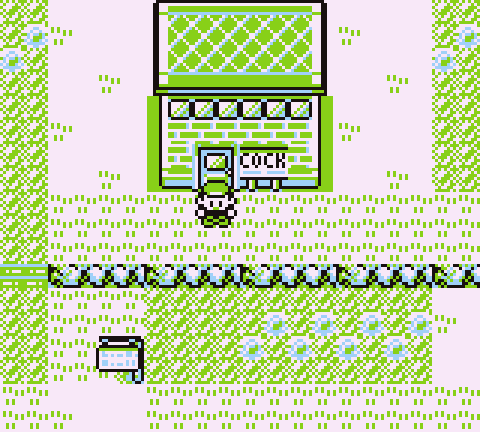
  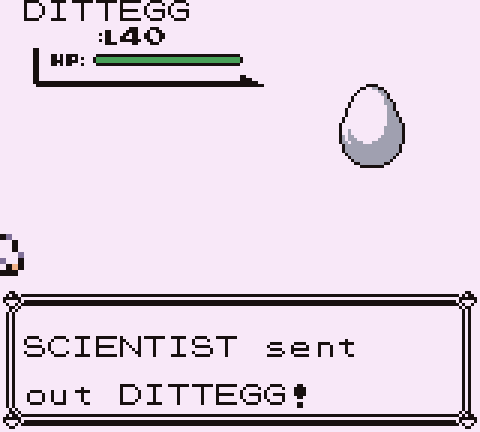
  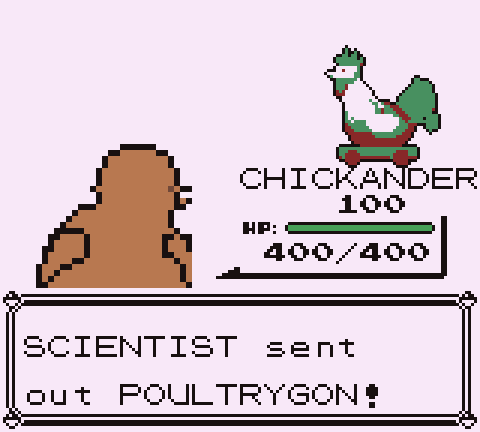

## Four places that were never there before

A fighting bird's life, from the wild to the ring and beyond. Where they are, and what's waiting in them, is for you to find.

<table>
  <tr>
    <td width="50%" valign="top">
      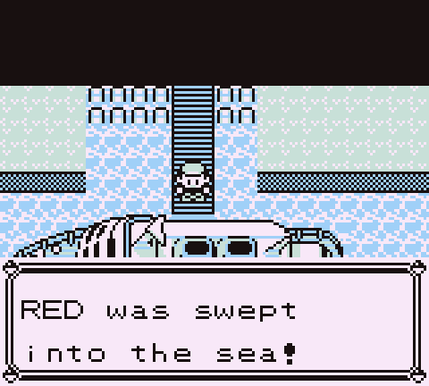 
      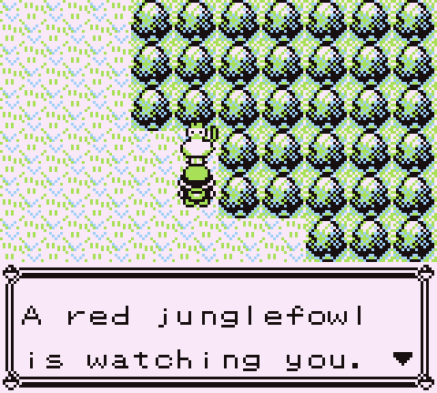 
      <b>Junglefowl Island</b> 
      It isn't on any map. The birds here have never had owners, and they'd like to keep it that way.
    </td>
    <td width="50%" valign="top">
      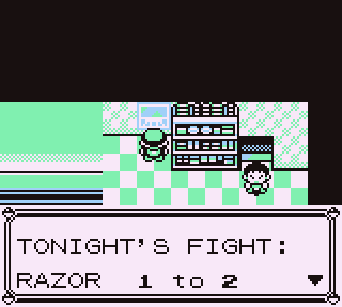 
      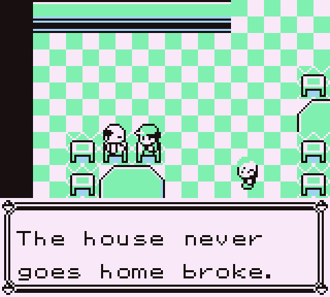 
      <b>The Pit</b> 
      Members only. The odds are posted, the crowd is loud, and somebody always knows how tonight ends.
    </td>
  </tr>
  <tr>
    <td width="50%" valign="top">
      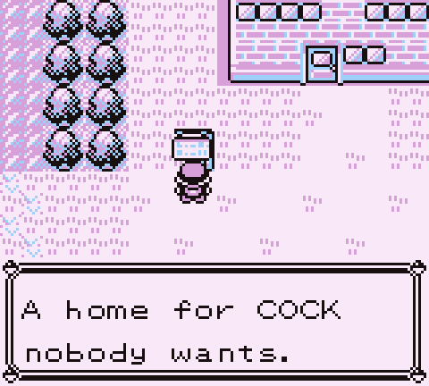 
      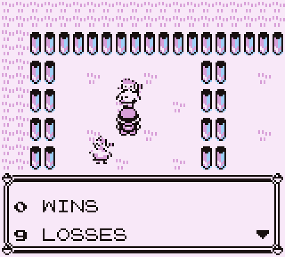 
      <b>Fuji Farm</b> 
      Every bird has to stop fighting some day. Some of them you'll recognise.
    </td>
    <td width="50%" valign="top">
      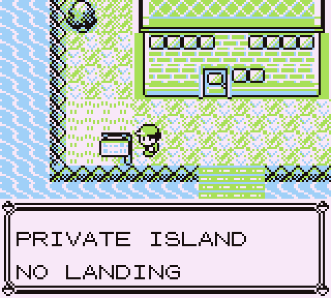 
      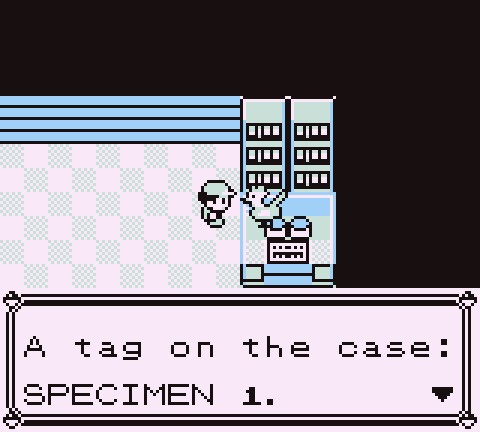 
      <b>Breeding Lab</b> 
      Someone set out to build the perfect fighter. Read the diaries. Mind the pens.
    </td>
  </tr>
</table>

## Play it

Build the ROMs yourself (see [**INSTALL.md**](INSTALL.md) for the tools), then run `make`. You get `rhodeislandred.gbc` and `bluewyandotte.gbc`. Play them in any Game Boy Color emulator, or on the real thing.

Spoilers live in the pull requests and in [**CLAUDE.md**](CLAUDE.md), which lists every breed and how everything works. Play first.

## Under the hood

Rooster Edition is a hack of the [pret disassembly][pret] of Pokémon Red and Blue, so it no longer matches the original ROMs' checksums. The upstream pret disassembly builds the following ROMs:

- Pokemon Red (UE) [S][!].gb `sha1: ea9bcae617fdf159b045185467ae58b2e4a48b9a`
- Pokemon Blue (UE) [S][!].gb `sha1: d7037c83e1ae5b39bde3c30787637ba1d4c48ce2`
- BLUEMONS.GB (debug build) `sha1: 5b1456177671b79b263c614ea0e7cc9ac542e9c4`
- dmgapae0.e69.patch `sha1: 0fb5f743696adfe1dbb2e062111f08f9bc5a293a`
- dmgapee0.e68.patch `sha1: ed4be94dc29c64271942c87f2157bca9ca1019c7`

To set up the repository, see [**INSTALL.md**](INSTALL.md).

## See also

- [**Wiki**][wiki] (includes [tutorials][tutorials])
- [**Symbols**][symbols]
- [**Tools**][tools]

You can find the pret team on [Discord (pret, #pokered)](https://discord.gg/d5dubZ3).

For other pret projects, see [pret.github.io](https://pret.github.io/).

[wiki]: https://github.com/pret/pokered/wiki
[tutorials]: https://github.com/pret/pokered/wiki/Tutorials
[symbols]: https://github.com/pret/pokered/tree/symbols
[tools]: https://github.com/pret/gb-asm-tools
[ci]: https://github.com/pret/pokered/actions
[ci-badge]: https://github.com/pret/pokered/actions/workflows/main.yml/badge.svg
[pret]: https://github.com/pret/pokered
